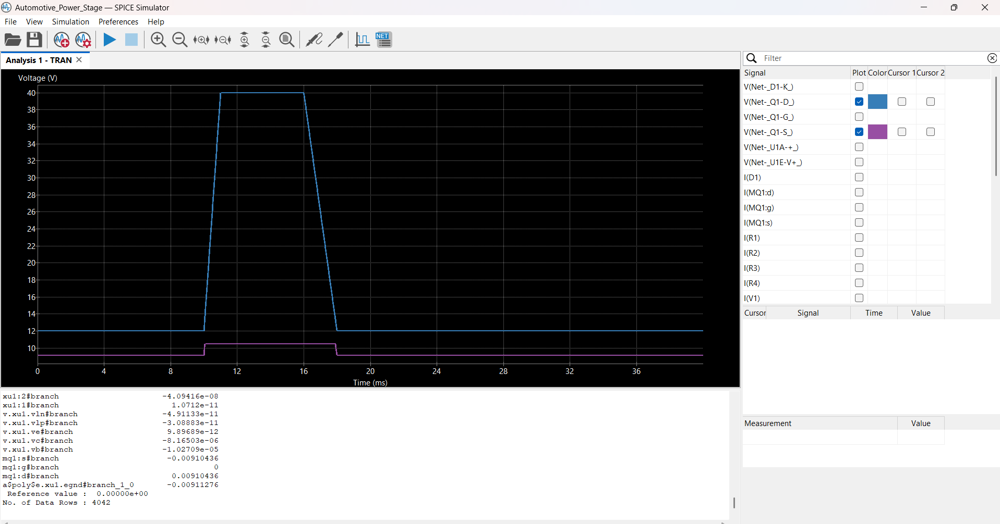

# Automotive Over-Voltage Power Protection Stage & SPICE Simulation

## Project Engineering Architecture
This project features the design, hardware modeling, and transient physical verification of an automotive-grade over-voltage protection cutoff stage using **KiCad** and the **ngspice** simulation engine. The circuit functions as a high-speed automated circuit breaker, shielding sensitive downstream automotive ECUs from destructive voltage spikes originating from the vehicle alternator loop.

## Simulation Parameters & Verification Waveforms
To validate compliance against rigorous industrial automotive benchmarking standards (ISO 7637-2 transient pulse profiles), the primary car battery power source was configured as a dynamic transient pulse:
* **Nominal Baseline Input:** 12V DC
* **Peak Transient Surge:** 40V Pulse
* **Surge Duration Profile:** 10ms baseline delay, 1ms rise ramp-up, 5ms peak saturation hold window, 2ms decay fall time.

### Real-World Testing Performance Results
Below are the calculated physical data waveform plots extracted from the 4,042 data rows processed by the SPICE physics solver engine:

* **Blue Wave (Input Rail):** Captures the raw, volatile alternator output power rail executing the 40V transient spike surge.
* **Purple Wave (Output Load Rail):** Demonstrates real-time automated safety isolation. The exact microsecond the incoming voltage crosses the target 15V sensing comparator threshold, the custom protection loop triggers, instantly dropping the load delivery down to **0V** and isolating downstream components from damage.

## Tools, Frameworks & Core Competencies
* **EDA Frameworks:** KiCad 8.0 Schematic Capture & Project Tree Management
* **Simulation Systems:** ngspice Custom Subcircuit Mapping Engines
* **Mathematical Modeling:** Industrial Texas Instruments LM324 Operational Amplifier PSpice Macro-model integrations
* **Core Domains:** Power Electronics Hardware Design, Voltage Sensing Network Calibrations, Automotive Transient Protection Systems

